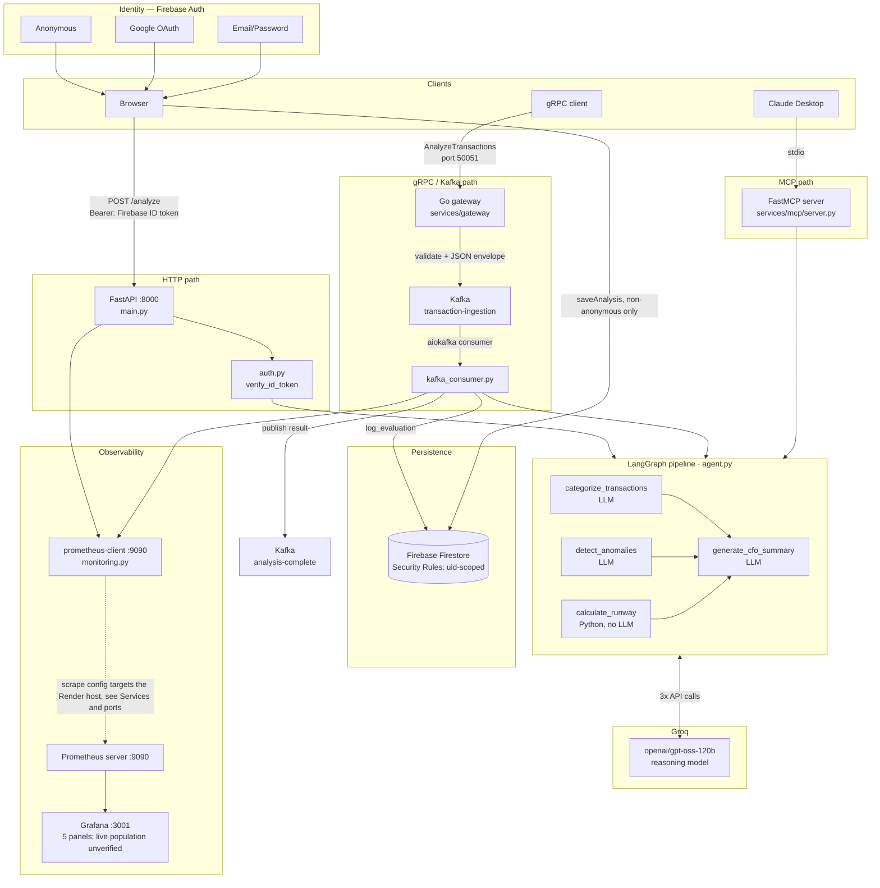

# Architecture

Baseline (repo name `cpg-cfo-agent`) has three ingestion paths that call the same LangGraph graph (3 LLM calls plus one deterministic Python node). Only the HTTP path validates input and builds the complete state; see [Path differences](#path-differences). A frontend auth layer gates two of the three access patterns (browser demo, browser dashboard) without touching the pipeline itself.

## System diagram



## Authentication

The full auth surface is: guest (anonymous Firebase user), Google OAuth, and email/password — all backed by one `firebase.auth.Auth` instance in `frontend/lib/firebase.ts`, and, since this session's work, a backend that actually checks the token instead of trusting whoever calls it.

### Why the backend didn't verify anything until recently

For most of this project's life, `POST /analyze` had no authentication check at all — no `Authorization` header inspection, no token verification, nothing. CORS restricts which browser origins may call it, but CORS is not an auth boundary; a non-browser client is unaffected by it. Closing that gap was layered on top of the existing three-provider auth system rather than a rewrite of it.

### The guest-token decision

The one design question that mattered here: if `/analyze` starts requiring a valid token, does the guest demo — the thing a recruiter clicks with zero signup friction — stop working?

The answer follows from how Firebase Anonymous Auth actually works: `signInAnonymously()` returns a completely normal ID token, signed the same way, verifiable the same way, with `token.firebase.sign_in_provider === "anonymous"` as the only tell. `firebase-admin`'s `verify_id_token()` succeeds for it exactly like it does for a Google or email/password token. So the backend can require *a* valid Firebase identity on every call to `/analyze` — closing the "anyone with `curl` and no account at all" gap — while still accepting the identity a guest already has. Nothing about the guest demo's UX changed; a signed-out visitor who clicks straight into `/demo` and runs an analysis with no prior sign-in gets an anonymous session created for them at analyze-time (in `frontend/lib/analyzeApi.ts`), then the token attaches to the request like it would for anyone else.

The alternative — leaving `/analyze` open regardless of token presence — was rejected because it doesn't fix anything; it just keeps the original gap.

### Frontend token attachment

`frontend/lib/analyzeApi.ts`'s `runAnalysis()` is the single place that calls `/analyze`, so it's also the single place that needed the token-attachment logic:

```ts
if (!auth.currentUser) {
  await signInAnon();               // on-demand, not on page load
}
const token = await auth.currentUser!.getIdToken();
// ...
headers: { Authorization: `Bearer ${token}` }
```

`getIdToken()` handles refresh transparently — Firebase ID tokens expire hourly, and the SDK re-mints one under the hood as long as the user's session is still valid, so this code doesn't need to think about expiry in the common case. A `401` response is mapped to a distinct `SessionExpiredError` so the UI can say "your session expired, refresh the page" instead of the generic "is the backend running?" message that a network failure would otherwise produce — those are different problems and deserve different error copy.

### Credential flow

Verifying an ID token needs two things: the project id (to check the token's audience) and Google's *public* signing certificates (to check the signature). It does **not** need privileged write access to anything — which is why local development only needs `FIREBASE_PROJECT_ID` in `backend/.env`, no service-account key. `backend/auth.py` supplies an explicit no-op credential (`google.auth.credentials.AnonymousCredentials`, wrapped in a small `_VerifyOnlyCredential` class) for this path — the naive assumption that `verify_id_token()` needs zero credentials at all turned out to be wrong (constructing the Admin SDK's auth client resolves Application Default Credentials regardless), so this class exists specifically to satisfy that requirement without handing local development a real key.

A hosted deployment is different: a stateless host has no natural place for a JSON file, so `auth.py` accepts the key as a single-line environment variable. The supported format is `FIREBASE_SERVICE_ACCOUNT_BASE64` — a service-account JSON, base64-encoded onto a single line:

```bash
base64 -i service-account.json | tr -d '\n'
```

`backend/auth.py` decodes it at startup and initializes the real Firebase Admin SDK with it. `.env.example` documents the resolution order: `FIREBASE_SERVICE_ACCOUNT_BASE64` (hosted) → `GOOGLE_APPLICATION_CREDENTIALS` (a file path — this is what `evaluation.py` already used for its own separate Firestore writes) → `FIREBASE_PROJECT_ID` (local dev, no key needed).

### Per-user data isolation

Isolation is enforced by Firestore Security Rules, not by application code:

```
allow create: if isRealUser() && request.resource.data.userId == request.auth.uid;
allow read:   if isRealUser() && resource.data.userId == request.auth.uid;
```

where `isRealUser()` additionally requires `request.auth.token.firebase.sign_in_provider != 'anonymous'`. This means a guest's Firestore *write* attempt is rejected by the rules engine itself, independent of whatever the frontend code does or doesn't check — the frontend does still skip the save call for anonymous users (in `frontend/app/demo/page.tsx` and `app/page.tsx`), but that's a UX nicety to avoid a pointless failed request, not the actual security boundary. If that client-side check had a bug, the rules would still hold. `frontend/app/dashboard/[id]/page.tsx` additionally checks `analysis.userId === user.uid` after fetching a document — belt-and-suspenders defense in depth against a document that somehow slipped through, even though the rules should make that impossible.

### Why the redesign kept the auth logic and only touched the styling

Across the visual redesigns (the app has since settled on a light earth-tone theme), `Navbar.tsx`'s `isGoogleUser` / `isGuest` checks and its `handleSignIn` / `handleSignOut` handlers stayed the same; only styling changed. The auth logic is identical across every route because the same component and the same `useAuth()` hook back every page.

## Data flow

### HTTP path

1. The browser attaches a Firebase ID token (`Authorization: Bearer <token>`) and uploads a CSV to `POST /analyze`.
2. `auth.py`'s `require_firebase_user` dependency verifies the token before any CSV parsing happens; a missing or invalid token short-circuits with a `401` and the pipeline never runs.
3. `main.py` runs `parse_transactions()` (UTF-8, empty/ragged/duplicate-header checks, required `date`/`amount` columns, numeric amounts, parseable dates; rows with a blank date or amount are dropped and counted in `metrics.rows_dropped`). Failures return a structured 422 before any LLM call. It then computes `monthly_burn` and `monthly_spend` and builds `AgentState` (including optional `cash_on_hand`).
4. `cfo_app.invoke()` runs `categorize`, `detect_anomalies` and `runway_calc` as one parallel step, then `summarize`.
5. FastAPI replaces `categories.total_by_category` with pandas-computed totals and returns the result JSON in a single response. Provider rate limits return 503 with `Retry-After`; other Groq errors 502; other failures 500.
6. If the caller is a real (non-anonymous) user, `saveAnalysis()` writes the result to Firestore under their UID; guests skip this step.
7. `monitoring.py` records `REQUEST_COUNT` and `REQUEST_LATENCY` for the `/analyze` endpoint label; `agent.py` records per-node time and prompt/completion tokens (instrumented in code; not verified against a live dashboard).

### gRPC / Kafka path

1. A gRPC client calls `AnalyzeTransactions` on the Go gateway (port 50051).
2. The gateway runs two validators (`ValidateCSV`, `ValidateSessionID`), which only check for non-empty values, generates a UUID job ID, and publishes a JSON envelope to `transaction-ingestion`.
3. `kafka_consumer.py` deserializes the message, reconstructs `AgentState` from `csv_data` with plain `pd.read_csv` / `to_datetime` (no `parse_transactions()`), and calls `cfo_app.invoke()`. It sets `monthly_revenue` to a hardcoded 100000 and does not set `monthly_spend` or `cash_on_hand`.
4. After the pipeline completes, `evaluation.py` writes a quality-scored record to Firestore `evaluations/`.
5. The result JSON is published to `analysis-complete` keyed by `job_id`.
6. `monitoring.py` records metrics under the `kafka` endpoint label.

This path has no Firebase ID-token concept at all — it's gRPC, not HTTP-from-a-browser, and was never in scope for the auth work. It's a genuinely separate trust boundary from the HTTP path.

### MCP path

1. Claude Desktop spawns `services/mcp/server.py` as a stdio subprocess (FastMCP).
2. Three tools are registered: `analyze_transactions`, `categorize_spend`, `get_runway_forecast`.
3. Each tool call parses the CSV with `_load_csv()` (invalid dates/amounts are coerced and those rows silently dropped; no `parse_transactions()`), infers `monthly_revenue` from the data (revenue-like columns, then positive amounts, then burn), then runs the relevant LangGraph nodes. It does not set `monthly_spend` or `cash_on_hand`.
4. Results are returned as structured dicts to Claude. The tool functions record no request count, latency or success-rate metrics, and `server.py` starts no metrics HTTP server. The shared nodes in `agent.py` still update the per-node time and token metrics in the MCP process, but nothing exposes them (read from source, not run).

### Path differences

| | HTTP | Kafka | MCP |
|---|---|---|---|
| Input validation | `parse_transactions()`, structured 422 | None beyond non-empty (gateway) | Coercion, silent row drop |
| `monthly_spend` in state | Set | **Not set** | **Not set** |
| `cash_on_hand` | Optional form field | Not passed | Not passed |
| `monthly_revenue` | Required form field | Hardcoded 100000 | Inferred from data |
| pandas `total_by_category` | Added | Not added | Not added |

`calculate_runway` treats a missing `monthly_spend` as 0, so on the Kafka and MCP paths it always reports that revenue covers spend. Their `runway` output is not meaningful until the state is fixed. No test covers this: the MCP tests use a fake pipeline.

The server is started with `MCP_SERVER.run()` and `services/mcp/README.md` documents stdio transport, so the intended use is a command-based server launched by a local client. The repo configures no network transport and no authentication for it; whether it has ever been exposed some other way is not recorded here.

## Design decisions

**Why LangGraph.** The analysis is split into narrow stages (categorize, detect anomalies, compute runway, summarize), each with its own output shape. LangGraph makes them explicit nodes, so a stage can be inspected or swapped independently and failures are attributable. Only three stages call the model: runway moved to Python after the model was found to return arbitrary values for arithmetic it was handed (see `eval/RESULTS.md`).

**Why Firestore over a relational database.** The data model here is genuinely simple: one `analyses` collection, documents scoped by `userId`, queried with `where('userId', '==', uid)` plus an `orderBy('createdAt')`. That doesn't need a schema migration story, connection pooling, or a hosted Postgres instance — it needs per-user document isolation, which Firestore Security Rules give directly without any backend code enforcing it.

**Why Firebase Auth ID tokens instead of a custom session/JWT scheme.** The frontend was already using Firebase Auth for sign-in; verifying the *same* tokens on the backend, rather than inventing a parallel session mechanism, meant zero new moving parts on the frontend (no new login flow, no new cookie, no new refresh logic) and a well-documented, security-reviewed verification path (`firebase-admin`'s `verify_id_token`) on the backend. The guest-token carve-out described above was the one piece of this that needed actual thought rather than just wiring up a library.

**Why guest mode exists at all.** The primary evaluator of a portfolio project is not going to create an account before deciding whether to keep reading. Guest mode is the demo's entire top-of-funnel; the auth work above was explicitly designed around not breaking it.

## Frontend structure

- `app/page.tsx` — public landing page (light earth-tone theme, no auth required to view).
- `app/demo/page.tsx` — the interactive demo. Same `UploadForm` / `Dashboard` components as the authenticated `/analyze` flow, but results aren't saved for anonymous users.
- `app/analyze/page.tsx` — authenticated upload flow; results are saved to Firestore and the user is offered a link into `/dashboard`.
- `app/dashboard/page.tsx`, `app/dashboard/[id]/page.tsx` — analysis history list and detail view, both gated on `isSignedIn = !!user && !user.isAnonymous`.
- `app/login/page.tsx`, `app/signup/page.tsx` — email/password forms plus a "Continue with Google" button, both redirecting to `/dashboard` on success and away from themselves if the visitor is already signed in with a real account.
- `components/Navbar.tsx` — the one place `isGoogleUser` / `isGuest` branching lives; every page renders the same component.
- `components/AnalysisProgress.tsx`, `ResultsSkeleton.tsx`, `AnalysisError.tsx` — staged loading UI (paced from recorded per-node means, i.e. an estimate, not a server progress signal), a results placeholder, and structured error cards for the API's error codes.
- `components/landing/` — the marketing sections (Hero, Problem, Pipeline, Capabilities, Architecture, Stack, FooterCTA), each a small, focused component rather than one long page file.

## Services and ports

| Service | Port | Notes |
|---------|------|-------|
| Next.js frontend | 3000 | Dev server; production on Vercel |
| FastAPI backend | 8000 | `/analyze` (token-gated), `/health` (open), `/docs` |
| Go gRPC gateway | 50051 | `FinancialAnalysisService.AnalyzeTransactions` |
| Kafka broker | 9092 | Confluent 7.6.0; internal hostname `kafka` in Docker Compose |
| Zookeeper | 2181 | Required by Confluent Kafka |
| prometheus-client | 9090 (container-internal) | Started by `monitoring.py` in the backend process. Note: the tracked Prometheus config does **not** target `backend:9090` |
| Prometheus server | 9090 (host) | Prometheus UI. The config rendered from `prometheus/prometheus.yml.template` scrapes `cpg-cfo-agent.onrender.com` over HTTPS every 5 s and `remote_write`s to a Grafana Cloud URL from `.env`; operation not verified, and the custom metrics' presence on that endpoint is unconfirmed |
| Grafana | 3001 | Dashboard auto-provisioned from `grafana/` |

## LangGraph pipeline nodes

All four nodes live in `backend/agent.py` and share a single `AgentState` TypedDict. Calls use `temperature=0.0`, `seed=42` (best-effort on Groq).

```
categorize_transactions   (LLM, json_object mode)
    Input:  csv_text[:3000] — a character slice of the re-serialized CSV; rows
            beyond the cut (and possibly a partial last row) are not seen.
    Output: categorized → {categories: {COGS: [{date, amount, description}], OpEx: [...]}}
            The model may return fewer items than it was given (observed on
            gpt-oss-120b). main.py adds total_by_category from pandas.

detect_anomalies          (LLM, json_object mode)
    Input:  df_summary = df.describe().to_string() — aggregate statistics only.
            No transaction rows; the date column is not expected to be present
            (based on pandas 2.x default behavior; not executed).
    Output: anomalies → {anomalies: [...], risk_level: "low|medium|high", actions: [...]}
            Supports "an extreme value exists" claims, not row identification.

calculate_runway          (Python, no LLM)
    Input:  monthly_spend, monthly_revenue, cash_on_hand (optional)
    Output: runway → {runway_months | null, monthly_spend, monthly_revenue,
            net_monthly_burn, cash_on_hand, basis, reason, recommendations}
            runway_months = cash_on_hand / (monthly_spend − monthly_revenue);
            null if cash is missing or revenue covers spend.

generate_cfo_summary      (LLM, free text)
    Input:  categorized, anomalies, runway
    Output: summary → str. The prompt asks for plain text with no markdown;
            this is a prompt instruction, not validated output.
```

Model: `openai/gpt-oss-120b`, a reasoning model (replaced `llama-3.3-70b-versatile`, which Groq retired).

**Graph edges.** Default: entry → `{categorize, detect_anomalies, runway_calc}` in parallel → `summarize` → END (`set_conditional_entry_point` fan-out). `BASELINE_SEQUENTIAL=1` restores `categorize → detect_anomalies → runway_calc → summarize`. The fan-out was verified concurrent on a synthetic graph; no end-to-end speed-up was demonstrated (inconclusive A/B, rate-limited), and fan-out concentrates tokens against the per-minute limit.

**Instrumentation.** Each node records `cpg_cfo_agent_execution_seconds`; LLM nodes also record prompt and completion tokens (reasoning tokens are included in completion). The histogram's top finite bucket is 10 s. This is code-level; no live Grafana check was made.

**Measurements.** Latency, determinism, anomaly recall/precision and corpus pass rates in `eval/RESULTS.md` were taken on `llama-3.3-70b-versatile`. On gpt-oss-120b only a smoke run, a markdown check, token cost (mean ~8,536/run, n=5) and the categorize completeness check were repeated (`eval/MIGRATION_NOTES.md`).

## Kafka envelope schema

JSON published to `transaction-ingestion` by the Go gateway:

```json
{
  "job_id":     "uuid-v4",
  "session_id": "caller-supplied session id",
  "csv_data":   "date,amount,...\n...",
  "user_id":    "caller-supplied user id",
  "timestamp":  "2026-06-26T12:00:00Z"
}
```

`user_id` and `session_id` are not read by the consumer. JSON published to `analysis-complete` by `kafka_consumer.py` (no pandas `total_by_category`; `runway` is unreliable, see Path differences):

```json
{
  "job_id":     "uuid-v4",
  "status":     "complete | error",
  "summary":    "...",
  "categories": {...},
  "anomalies":  {...},
  "runway":     {...}
}
```

## Firestore schema

**`analyses/{auto-id}`** — written by the HTTP path for signed-in (non-anonymous) users only.

```json
{
  "fileName":  "sample_transactions.csv",
  "summary":   "...",
  "categories": {...},
  "anomalies": {...},
  "runway":    {...},
  "metrics":   {...},
  "userId":    "firebase-uid",
  "createdAt": "server timestamp"
}
```

Gated entirely by the Security Rules described above — `userId` on write must equal `request.auth.uid`, and the caller's sign-in provider must not be `anonymous`.

**`evaluations/{auto-id}`** — written after every Kafka-path pipeline run, unrelated to the per-user auth system above (this is server-side logging via a service account, not a per-user document).

```json
{
  "job_id":           "uuid-v4",
  "input_hash":       "sha256 of csv_data",
  "agent_outputs":    {"categorized": "...", "anomalies": "...", "runway": "..."},
  "latencies_seconds": {"total_seconds": 4.2},
  "quality_score":    100,
  "quality_reasons":  [],
  "timestamp":        "2026-06-26T12:00:00+00:00"
}
```

Quality score (0–100), `backend/evaluation.py`: +40 if `summary` ≥ 100 chars; +20 each for non-empty `categorized`, `anomalies`, `runway`. It measures output completeness only, not financial accuracy, schema validity or model quality (a parse-failure fallback dict with `_parse_error` is non-empty and still scores). `agent_outputs` are stored as strings truncated to 2,000 characters; written only by the Kafka consumer.

## Deployment architecture

| Environment | Frontend | Backend | Notes |
|---|---|---|---|
| Local dev | `npm run dev` (port 3000) | `uvicorn --reload` (port 8000) | `FIREBASE_PROJECT_ID` only — no service-account key needed to verify tokens |
| Docker Compose | Same container as prod build | Same image as prod, plus Kafka/gateway/Prometheus/Grafana | Full stack, one command |
| Production | Vercel | Render (per README; no config tracked here) | Separate deploy targets; no shared infra described |

**Hosting notes.** No Render or Vercel configuration is tracked in this repo, so the deployed settings, hosting tier, cold-start behavior and rollout history are not documented or verifiable here. The frontend shows a "waking up" notice after 10 s of waiting; it fires on elapsed time alone. For ordering, note that `/analyze` rejects requests without a valid Firebase token (`auth.py`), so a frontend that does not send tokens cannot call a backend that has this check.

## Kubernetes topology

All workloads in namespace `cpg-cfo-agent`. No validation output or deployment record is kept in this repo, so neither "validated" nor "never deployed" is established here. Known gaps in the manifests as written: images point at `ghcr.io/gaurannggg7/cpg-cfo-agent/*:latest` with no workflow that builds or pushes them; the backend Deployment passes only `KAFKA_BOOTSTRAP_SERVERS` and `GROQ_API_KEY`, while `FIREBASE_PROJECT_ID` is in the ConfigMap (still the `REPLACE_WITH_YOUR_PROJECT_ID` placeholder) but not referenced, and `auth.py` raises when no Firebase credential variable is set.

| Deployment | Replicas | HPA |
|-----------|----------|-----|
| gateway | 2 | 2–5 replicas at 70% CPU |
| backend | 2 | none |
| frontend | 1 | none |
| kafka | 1 | none |

The HPA (`k8s/hpa.yaml`) targets the `gateway` deployment. Scale-up stabilization is 30s; scale-down is 300s. Requires the Kubernetes Metrics Server.

The backend deployment exposes two container ports: `8000` (HTTP) and `9090` (metrics). The nginx Ingress routes external HTTP traffic. The gateway is exposed on port 50051 via its own Service.

## Tests and CI

No CI workflow is checked in (`.github/` absent), so there is no repository evidence of automated runs. Existing automated tests: Go gateway validators (`services/gateway/gateway_test.go`, empty-input checks only) and MCP server tests (`services/mcp/test_server.py`) that use a fake pipeline. Nothing tests `parse_transactions`, `agent.py`, `/analyze` or the frontend. The `eval/` scripts are live-API measurement harnesses, not regression tests. These tests were not run while this documentation was written.
